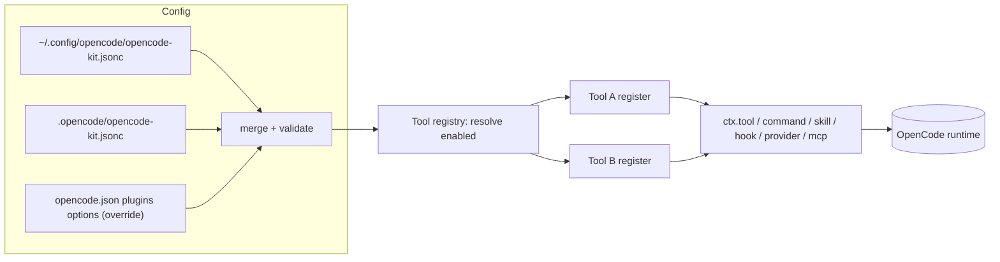

# opencode-kit — Design Spec

- **Date:** 2026-10-01
- **Status:** Draft for review
- **Author:** (agent-assisted)
- **Topic:** A framework for building and distributing OpenCode V2 tools

## 1. Summary

`opencode-kit` is a single, publicly distributable OpenCode V2 plugin package that
hosts a set of independently toggleable **tools**. A tool is a self-contained
module that may contribute agent-callable functions, slash commands, skills,
instruction/hook injections, bundled scripts, and CLIs. Consumers install the kit
once, then enable/disable and tune each tool through configuration.

The kit is designed to be grown over time: adding a tool is dropping a folder and
registering it; the framework handles discovery, configuration, isolation, CLI,
and documentation surfaces.

## 2. Context and intent

- **Audience:** the author plus public users (open GitHub repo, npm publish).
- **Posture:** framework-first. The framework and its conventions matter more than
  any single tool; the first real tools come later.
- **Consumer model:** install the kit once, then toggle individual tools.
- **Non-goals (for v1):**
  - Independently installable/versioned tools (a monorepo of plugins). The
    architecture leaves a mechanical upgrade path to this later.
  - Runtime drop-in discovery for third-party tool authoring (a "framework others
    build on"). Explicit, typed registration is used instead.
  - Non-OpenCode harnesses. This is OpenCode V2 only.

## 3. Constraints and facts

- OpenCode V2 plugin entrypoint: `Plugin.define({ id, setup(ctx) })` from
  `@opencode/plugin`.
- Plugins are loaded from `plugins` in `opencode.json(c)` as npm names, git specs,
  local directories (containing `index.js`), or via `.opencode/plugins/`
  auto-discovery. Per-install options are read from `ctx.options`.
- OpenCode's `plugins` array can disable **whole plugin IDs** (`-id`), not
  individual tools. **Per-tool enable/disable is therefore implemented by the kit.**
- A plugin can register: tools (`ctx.tool.transform`), commands
  (`ctx.command.transform`), skills (`ctx.skill.transform`), agents
  (`ctx.agent.transform`), providers/models, MCP servers
  (`ctx.mcp.transform`), references, websearch providers, VCS, worktrees, and can
  intercept prompts/requests via `ctx.session.hook(...)`. It has durable JSON
  storage (`ctx.storage`) and can call a model (`ctx.generate.text`).
- `opencode plugin add <pkg>` installs into OpenCode's cache
  (`~/.cache/opencode/npm/...`), **not** the shell `PATH`. A package `bin/` entry
  is not automatically a global command.
- Requires OpenCode V2 >= 2.0.4 (author is on 2.0.21).

## 4. Architecture

### 4.1 Components

- **Kit runtime (plugin):** default export of the package; `Plugin.define` with
  `id: "opencode-kit"`. `setup` loads config, resolves enabled tools and their
  settings, registers each tool's capabilities, and returns a cleanup that
  disposes all registrations on unload.
- **Config layer:** discovers and merges global/project config, validates against
  schema, applies defaults, exposes resolved per-tool settings.
- **Tool registry:** the set of available `KitTool` modules; resolves the enabled
  subset and registers each in isolation.
- **KitTool contract:** the shared interface every tool implements (Section 5).
- **CLI** (`bin/opencode-kit`): `init`, `list`, `enable`/`disable`,
  `config get|set`, `new`, `doctor`, `version`.
- **Agent setup:** `.opencode/INSTALL.md` an agent can fetch and follow.
- **Scripts:** bundled per tool, invoked through registered tools/commands (and/or
  the CLI) so they never require `PATH`.

### 4.2 Data flow

```text
setup:   config files -> merge -> validate -> enabled tools -> register capabilities
                                                             (tracked, disposable)
runtime: agent invokes tool/command -> execute(settings, input, ctx)
reload:  config change -> dispose all -> re-resolve -> re-register
```



### 4.3 Repo layout

```text
opencode-kit/
  package.json
  index.js                  # V2 directory-form entry -> src/plugin.ts
  bin/opencode-kit.js       # CLI (npm bin)
  src/
    plugin.ts               # Plugin.define + setup orchestration
    config/                 # schema, defaults, load, merge
    core/
      tool.ts               # defineTool() + KitTool/KitApi types
      registry.ts           # enabled resolution + isolated registration
      paths.ts, logger.ts
    tools/
      <tool-id>/            # index.ts, settings.ts, scripts/, README.md, test/
    cli/                    # index.ts, commands/*.ts
  skills/                   # optional kit-provided skills
  .opencode/INSTALL.md      # agent-driven setup
  docs/
    superpowers/specs/      # this and future specs
  examples/  tests/
  opencode-kit.schema.json
  README.md  LICENSE  AGENTS.md  CONTRIBUTING.md
```

## 5. KitTool contract

```ts
import type { PluginContext } from "@opencode/plugin"

export interface KitTool<S = unknown> {
  id: string                       // unique, kebab-case, e.g. "conventional-commits"
  name: string                     // display name
  description: string              // one line, shown in `opencode-kit list`
  defaultEnabled?: boolean         // default false (opt-in)
  defaultSettings: S
  settingsSchema?: object          // JSON Schema -> validation, docs, CLI
  register(ctx: PluginContext, settings: S, kit: KitApi): void | Promise<void>
}

export interface KitApi {
  namespace(toolId: string): void  // avoids cross-tool name collisions
  scriptPath(name: string): string // absolute path inside the installed package
  storage: PluginContext["storage"]
  log: Logger
  version: string
}
```

`register` is the single underlying mechanism; `defineTool()` adds typing and
optional introspection. A tool declares what it needs inside `register`, e.g.:

```ts
export default defineTool({
  id: "conventional-commits",
  name: "Conventional Commits",
  description: "Validate and help write conventional commit messages",
  defaultSettings: { types: ["feat", "fix", "chore"], maxLength: 72 },
  settingsSchema: { /* JSON Schema */ },
  async register(ctx, settings, kit) {
    kit.namespace("cc")
    await ctx.tool.transform((e) =>
      e.add({ name: "check", description: "Validate a commit message",
              input: {/* schema */}, execute: (input) => runCheck(input, settings) }))
    await ctx.session.hook("prompt", (event) => {
      event.prompt.files ??= []
      event.prompt.files.push({ uri: `file://${kit.scriptPath("guidance.md")}` })
    })
    await ctx.skill.transform((e) =>
      e.add({ id: "cc", name: "Conventional Commits", description: "…",
              path: kit.scriptPath("SKILL.md"),
              content: readFileSync(kit.scriptPath("SKILL.md"), "utf8") }))
  },
})
```

### 5.1 Registration flow

1. Load + merge + validate config -> resolved `Map<toolId, settings>`.
2. For each enabled tool, call `register(ctx, settings, kit)` inside **try/catch**.
   A failure is logged with the tool ID and recorded in a **degraded list**; other
   tools still load.
3. Collect every transform's `Registration` (disposable); return one aggregate
   cleanup so unloading releases everything.
4. If a tool throws mid-registration, its partial registrations are disposed so it
   cannot leave half-registered hooks behind.

### 5.2 Enable/disable semantics

- **Whole kit:** native — present/absent (or `-opencode-kit`) in `opencode.json`.
- **Per tool:** `tools.<id>.enabled` in kit config. A disabled tool's `register`
  never runs, so none of its tools/commands/hooks/skills/models exist.
- **Missing entry -> `defaultEnabled ?? false`.**
  `opencode-kit init` seeds every known tool with its declared default so behavior
  is explicit. Tools intended to work out of the box set `defaultEnabled: true`;
  tools that are situational leave it false, so a fresh `init` never silently
  activates something the user did not ask for.

## 6. Configuration model

### 6.1 Locations and discovery

- **Global:** `~/.config/opencode/opencode-kit.jsonc` (respects `XDG_CONFIG_HOME`).
- **Project:** `<project>/.opencode/opencode-kit.jsonc`, discovered from the
  instance location (`ctx.location.directory`) upward, nearest wins.

One form (`.opencode/…`) keeps the merge rules simple.

### 6.2 Precedence (low -> high)

```text
tool.defaultSettings (code)
  < global opencode-kit.jsonc
    < project opencode-kit.jsonc (farther -> nearer)
      < opencode.json plugins[].options (explicit override)
```

**Merge semantics:** `settings` objects deep-merge per tool; scalars (`enabled`)
replace; **arrays replace** (not concat), matching OpenCode's rule.

### 6.3 Validation and failure behavior

- Kit config declares `$schema`; the plugin validates each tool's `settings`
  against its `settingsSchema`.
- Invalid settings for one tool -> log a warning and use that tool's defaults (or
  mark it degraded). It never blocks the kit from loading.
- Stretch (likely deferred): `{env:VAR}` interpolation for secret-bearing settings.

### 6.4 Reload

Rebuild, not mutate:

```text
config file changes (fs.watch, debounced)
  -> dispose ALL previous registrations
    -> re-resolve enabled tools + settings
      -> re-run registration
```

The CLI may trigger `opencode service restart` as a fallback.

### 6.5 Example

```jsonc
// ~/.config/opencode/opencode-kit.jsonc
{
  "$schema": "https://raw.githubusercontent.com/<you>/opencode-kit/main/opencode-kit.schema.json",
  "tools": {
    "conventional-commits": { "enabled": true, "settings": { "maxLength": 50 } },
    "release-helper":       { "enabled": false }
  }
}
```

```jsonc
// <project>/.opencode/opencode-kit.jsonc  — only what differs
{
  "tools": { "conventional-commits": { "settings": { "types": ["feat", "fix"] } } }
}
```

## 7. CLI

| Command | Does |
|---|---|
| `init [--project]` | Create kit config (global or project), seed every known tool with its default, ensure the `opencode.json` plugin entry exists |
| `list` | Show tools, enabled/disabled, and capabilities each provides |
| `enable <tool>` / `disable <tool>` | Flip `tools.<id>.enabled` |
| `config get <tool> [key]` / `config set <tool> <key> <value>` | Read/write a tool's settings |
| `new <tool-id>` | Scaffold a tool folder and update the registry barrel |
| `doctor` | Verify plugin is active (`/api/plugin`), config validates, no degraded tools |
| `version` | Print CLI + plugin versions |

Config edits use a **comment-preserving JSONC editor** so hand-written comments
survive CLI writes.

## 8. Installation and distribution

### 8.1 Consumer install

- Primary: `opencode plugin add opencode-kit` (installs into OpenCode's cache;
  registers all enabled tools). The `.opencode/INSTALL.md` flow is equivalent and
  agent-driven.
- CLI access: `npx opencode-kit …` out of the box, and `npm i -g opencode-kit` for
  a permanent command. A `/kit` slash command registered by the plugin covers
  users who install neither.

### 8.2 Agent-driven setup

Ship `.opencode/INSTALL.md` following the Superpowers pattern:

> Fetch and follow instructions from
> https://raw.githubusercontent.com/&lt;you&gt;/opencode-kit/main/.opencode/INSTALL.md

The file guides the agent to: add the plugin entry, write/seed
`opencode-kit.jsonc`, restart the service, and verify with `doctor`. A registered
`/kit` command lets the agent list/enable/configure tools from inside a session.

### 8.3 Packaging and versioning

- One npm package `opencode-kit` (plugin + CLI).
- SemVer; pin with `opencode-kit@1.2.0`, track latest via the git spec.
- `CHANGELOG.md`, GitHub Releases/tags.
- Config schema versioned (`"configVersion": 1`) with migrations.
- Public hygiene: `README.md`, `docs/`, an `examples/` tool, `LICENSE` (MIT),
  `CONTRIBUTING.md`, issue/PR templates.

## 9. Isolation and error handling

- Per-tool `register()` in try/catch; failures logged and listed as degraded.
- Partial registrations disposed on mid-register failure.
- Namespacing + `kit.wrap()` helper isolate executors/hooks.
- Settings validated before register; invalid -> defaults + warning.
- Bundled scripts run with a timeout and honor `context.signal`.
- Namespaced logger with levels for attributable failures.

## 10. Testing and CI

- **Unit** (per tool): settings parsing, pure logic.
- **Config layer:** discovery, precedence, deep-merge, array-replace.
- **Registry:** enable/disable, and a throwing tool does not break others.
- **Harness integration:** a fake `ctx` recording registrations; assert a tool's
  expected tools/commands/hooks/skills without a live OpenCode.
- **Live smoke** (optional, CI): `opencode --standalone`; assert `/api/plugin`
  shows `opencode-kit` active and a tool appears.
- **GitHub Actions:** typecheck + lint + tests on PR; publish-on-tag workflow.

## 11. Adding a tool (authoring workflow)

```text
1. opencode-kit new my-tool          # scaffolds index.ts, settings.ts, README.md, test/
2. implement register(ctx, settings, kit)
3. unit + harness tests
4. registry barrel updated by the scaffolder (explicit, typed)
5. settingsSchema drives auto-generated docs + `list` output
6. add an example entry to docs/examples
```

Tool discovery stays explicit (a typed barrel), not runtime globbing.

## 12. Open questions

- Package scope/name for npm (`opencode-kit` unqualified may be taken); decide at
  publish time.
- Whether `{env:VAR}` interpolation ships in v1 or later.
- Exact shape of auto-generated docs from `settingsSchema` (nice-to-have).

## 13. Success criteria

- A user can install with one command (or one agent instruction), then
  enable/disable and tune tools from config.
- Adding a new tool touches one folder plus registry/docs entries.
- One failing tool does not prevent the kit or other tools from loading.
- Config supports global defaults plus per-project overrides, with predictable
  precedence.
