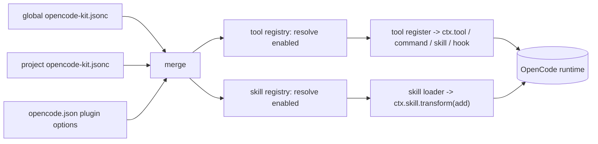

# opencode-kit — Skills Category Design Spec

- **Date:** 2026-10-08
- **Status:** Draft for review
- **Author:** (agent-assisted)
- **Topic:** Promote **skills** to a first-class, independently toggleable artifact category beside tools, and ship the first two skills (`english-writing-assistant`, `sdd-flow`)

## 1. Summary

`opencode-kit` today is a framework of independently toggleable **tools**. A tool can
already contribute a skill at runtime through `KitApi.skill` / `ctx.skill.transform`,
but the kit ships no skills and has no first-class concept of one.

This spec adds **skills** as a second, independent artifact category:

- A skill is a self-contained directory `src/skills/<id>/SKILL.md` plus optional
  supporting files. It is entirely declarative — **no per-skill code**.
- Skills get their own config section (`skills.<id>.enabled`), resolved state, and
  first-class treatment in `list`, `enable`/`disable`, `init`, and `doctor`.
- The kit ships two skills: `english-writing-assistant` (model-visible) and
  `sdd-flow` (registered `autoinvoke: false`, loadable explicitly).

Adding a skill becomes *drop a folder + add one barrel line*. Adding a skill does
**not** require a tool, and the existing tool-contributed-skill path is unchanged —
this is a superset, not a replacement.

## 2. Context and intent

- **Audience:** the author plus public users of the open GitHub repo.
- **Posture:** framework-first. Skills are a first-class part of the kit, curated and
  shipped by the kit, not a minor internal feature of one tool.
- **Why a category rather than a tool:** the first two skills are unrelated to each
  other and to any behavioral tool. A single "skills" tool would be a bag whose
  per-skill switches are nested in settings (`tools.skills.settings.skills.<id>`),
  and a tool-per-skill would mislabel skills as tools and bloat the tool list. A peer
  category gives each skill independent enable/disable and cheap authoring.
- **Non-goals:**
  - Per-skill settings knobs. Skills are content; only `enabled` is configurable.
  - Remote/HTTP skill catalogs or third-party drop-in discovery.
  - A `/sdd-flow` slash command. Explicit invocation is `@sdd-flow`.
  - Changing or removing `KitApi.skill` / tool-contributed skills.
  - Auto-adapting the vendored sdd-flow content for OpenCode (see §11).

## 3. Constraints and facts

- OpenCode V2 plugin context already exposes the skill domain:
  `ctx.skill.transform((editor) => editor.add(skillInfo))`. The kit's
  `src/core/context.ts` already declares `SkillDomain`, `SkillEditor`,
  `SkillDefinition` (currently `{ id, name, description?, path?, content? }`), and
  `KitContext.skill`; `KitApi.skill` (`src/core/kit-api.ts`) and the registry tracking
  wrapper (`src/core/registry.ts`) already handle it. `createFakeContext`
  (`src/core/testing.ts`) already records `calls.skill`.
- V2 `SkillInfo` (per the plugin API reference) is `{ id, name, description, path?,
  content?, autoinvoke? }`. `content` is the Markdown body; `path` points at the
  skill's `SKILL.md` and gives the skill a base directory.
- **Paths inside a skill are resolved relative to the directory containing
  `SKILL.md`**, and a directory-based skill is given a supporting-file list (up to 10
  paths). `sdd-flow` references `spec-template.md`, `step-format.md`, and
  `update-refs.sh` relative to its base directory, so the kit must register it with a
  real `path`, not only inline `content`.
- V2 frontmatter fields that matter: `name`, `description`, and
  `metadata.opencode/autoinvoke: false` (alias `disable-model-invocation: true`).
  `autoinvoke: false` hides a skill from the model's advertised list while keeping it
  loadable by ID (e.g. `@sdd-flow`). Source: <https://opencode.ai/v2/docs/skills/>.
- The plugin is transpiled by Bun at load; there is **no build step**. `package.json`
  `files` already includes `src`, so skill files under `src/skills/` ship as-is and can
  be read at registration with `node:fs`.
- Config is JSONC edited comment-preservingly via `jsonc-parser` (`src/config/edit.ts`).
  The top-level schema sets `additionalProperties: false`, so a new `skills` key must be
  added explicitly.
- The current `KitConfigFile`/`ToolConfigEntry`/`ResolvedToolConfig` and
  `resolveToolConfig` are tool-specific (`tools.<id>` literals). `deepMerge` /
  `mergeConfigFiles` are generic and need no change.

## 4. Architecture

### 4.1 Components

- **Skill package:** `src/skills/<id>/SKILL.md` (+ optional support files). Portable
  Markdown; frontmatter is standard V2 frontmatter.
- **Skill contract & loader (`src/core/skill.ts`):** `KitSkill`, `defineSkill`, a
  frontmatter reader, `loadSkill`, and `registerSkill`.
- **Skill barrel (`src/skills/index.ts`):** explicit, typed enumeration with
  `// <kit:skills>` markers — the single source of truth for which skills exist.
- **Config layer:** gains a `skills.<id>.enabled` section with the same discovery,
  precedence, and comment-preserving edit machinery as tools.
- **Skill registry:** resolves the enabled subset and registers each skill in
  isolation, contributing to the same degraded list as tools.
- **CLI / `/kit`:** `list`, `enable`/`disable`, `init`, and `doctor` become
  category-aware; `new-skill` scaffolds a skill. `config` stays tools-only.

### 4.2 Data flow

```text
setup:   config files -> merge -> resolve tools -> register tools
                              \-> resolve skills -> register skills   (isolated, disposable)
runtime: skill is advertised / loaded by the harness from its registration
reload:  config change -> dispose all (tools + skills) -> re-resolve -> re-register
```



### 4.3 Repo layout (delta)

```text
src/
  core/
    skill.ts            # NEW: KitSkill, defineSkill, loadSkill, registerSkill, frontmatter reader
  skills/               # NEW: first-class skill packages
    index.ts            # barrel with <kit:skills> markers
    english-writing-assistant/
      SKILL.md
    sdd-flow/
      SKILL.md
      spec-template.md
      step-format.md
      update-refs.sh
  config/               # types/resolve/edit/effective gain a skills section
  cli/
    scaffold.ts         # + scaffoldSkill / renderSkill / skills-barrel update
    commands/new-skill.ts   # NEW
tests/unit, tests/integration   # new/extended coverage
```

## 5. Skill contract and package format

```ts
// src/core/skill.ts
export interface KitSkill {
  /** Unique, kebab-case id; also the config key and skill id. */
  id: string
  /** Directory containing SKILL.md (and supporting files), as a URL. */
  dir: URL
  /** Bundled skills default ON so installing the kit makes them available. */
  defaultEnabled?: boolean
}

/** Normalizes the default: bundled skills are enabled unless they opt out. */
export function defineSkill(skill: KitSkill): KitSkill {
  return { defaultEnabled: true, ...skill }
}
```

`src/skills/index.ts`:

```ts
import { defineSkill, type KitSkill } from "../core/skill"

/** Every skill shipped by opencode-kit. `<kit:skills>` markers must stay intact. */
export const skills: KitSkill[] = [
  // <kit:skills>
  defineSkill({ id: "english-writing-assistant", dir: new URL("./english-writing-assistant/", import.meta.url) }),
  defineSkill({ id: "sdd-flow", dir: new URL("./sdd-flow/", import.meta.url) }),
  // </kit:skills>
]
```

### 5.1 Frontmatter reader

`SKILL.md` is the single source of truth for `name`, `description`, and
`autoinvoke` (portable, no duplication in the barrel). A small, tested reader
(`readSkillFrontmatter(text)`) extracts only the fields the kit needs:

- `name`: plain or single/double-quoted single-line scalar.
- `description`: plain/quoted single-line, or a folded (`>` / `>-`) or literal (`|` /
  `|-`) block joined by spaces / newlines. This is required because
  `english-writing-assistant` uses a folded `>-` description.
- `metadata.opencode/autoinvoke: true|false`, and the alias
  `disable-model-invocation: true|false`.
- All other keys are ignored.

It is deliberately a focused subset reader, **not** a general YAML implementation; on
any parse failure the loader falls back to `name = id`, `description = undefined`
(which V2 treats as "not advertised") rather than throwing. Unit tests parse the two
real bundled files.

### 5.2 Loading and registering

```ts
export interface LoadedSkill {
  info: {
    id: string
    name: string
    description?: string
    path: string        // absolute path to SKILL.md
    content: string     // Markdown body, frontmatter stripped
    autoinvoke?: boolean
  }
}

/** Reads dir/SKILL.md; throws if the file is missing or unreadable. */
export function loadSkill(skill: KitSkill): LoadedSkill

/** Registers one skill: ctx.skill.transform((e) => e.add(loadedSkill.info)). */
export async function registerSkill(ctx: KitContext, skill: KitSkill): Promise<Registration>
```

- `path` is the real absolute path (`fileURLToPath(new URL("SKILL.md", skill.dir))`) so
  V2 treats the skill as directory-based and gives it a base directory + supporting-file
  sample — required for sdd-flow's relative references.
- `content` is the body with the leading frontmatter block removed, so the harness does
  not render frontmatter.
- `autoinvoke` is set on the definition only when frontmatter says `false` (or
  `disable-model-invocation: true`); omitted otherwise.
- `SkillDefinition` in `src/core/context.ts` gains an optional `autoinvoke?: boolean`
  field for typing.

## 6. Configuration model

### 6.1 Shape

```ts
export interface SkillConfigEntry {
  enabled?: boolean
}

export interface KitConfigFile {
  configVersion?: number
  tools?: Record<string, ToolConfigEntry>
  skills?: Record<string, SkillConfigEntry>   // NEW
}

export interface ResolvedSkillConfig {
  enabled: boolean
}
```

Example:

```jsonc
{
  "$schema": "https://raw.githubusercontent.com/jviniciusb/opencode-kit/main/opencode-kit.schema.json",
  "configVersion": 1,
  "tools": { "hello": { "enabled": true } },
  "skills": {
    "english-writing-assistant": { "enabled": true },
    "sdd-flow": { "enabled": true }
  }
}
```

### 6.2 Resolution

`resolveSkillConfig(skill, sources)` mirrors `resolveToolConfig`:

- start from `skill.defaultEnabled` (default **true** for skills);
- fold each source's `skills[skill.id].enabled` (replace);
- sources for other ids are ignored.

**Intentional difference from tools:** a missing skills entry means the skill defaults
**on** (bundled, curated content works on install), whereas a missing tools entry means
**off**. `init` still seeds explicit entries so the effective state is obvious.

`effective.ts` gains `resolveSkillEffective(skill, layers)` returning `{ enabled,
enabledLayer? }`, reusing the existing `buildConfigLayers` / `readPluginOptions`
layers. `deepMerge`/`mergeConfigFiles` handle the new section unchanged.

### 6.3 Editing

`edit.ts` gains:

- `setSkillEnabled(path, skillId, enabled)` → `modify(text, ["skills", skillId,
  "enabled"], enabled)`.
- `seedSkills(path, seeds)` → inserts missing `skills[id]` entries only.

Both reuse the existing comment-preserving `readConfigText` / `modify` / `applyEdits`
path. The internal `setEntryEnabled` / `seedEntries` logic is factored so tools and
skills share one implementation. `DEFAULT_CONFIG` becomes `{ configVersion: 1, tools: {},
skills: {} }`.

## 7. Registry and lifecycle

### 7.1 Skill registration

```ts
// src/core/registry.ts
export async function registerSkills(
  skills: KitSkill[],
  resolved: Map<string, ResolvedSkillConfig>,
  ctx: KitContext,
): Promise<{ registrations: Registration[]; degraded: DegradedItem[] }>
```

- For each skill whose resolved config is `enabled: true`, call `registerSkill` in a
  `try/catch`.
- A missing/malformed `SKILL.md` degrades **only that skill**; other skills, all tools,
  and the kit keep loading.
- Registrations are collected for disposal.

### 7.2 Unified degradation

`DegradedTool` is generalized to:

```ts
export interface DegradedItem {
  kind: "tool" | "skill"
  id: string
  error: string
}
```

`BootstrapResult.degraded` becomes `DegradedItem[]`; `bootstrap` logs
`opencode-kit: <kind> "<id>" degraded: <error>` for each. (Existing tests that assert
degraded tools are updated to include `kind: "tool"`.)

### 7.3 Bootstrap and lifecycle wiring

- `bootstrap(ctx, tools, skills, options?)` resolves+validates tool settings as today,
  then resolves skill config, then runs `registerTools` and `registerSkills`. Its
  returned `dispose` releases **both** sets of registrations (even if one disposer
  throws).
- `createLifecycle(ctx, tools, skills, options?, watch?)` passes both through
  `bootstrap`; `reload`/`dispose` already rebuild/dispose the whole generation.
- `src/plugin.ts` default export imports `skills` and passes it alongside `tools`.

## 8. CLI and `/kit`

| Command | Change |
| --- | --- |
| `list` | Prints a `tools:` section and a `skills:` section; each line `<id>\t<enabled\|disabled>\t<description>`. |
| `enable <id>` / `disable <id>` | Resolves `<id>` across tools **and** skills (ids must be unique across categories); writes the matching `tools.<id>.enabled` or `skills.<id>.enabled`; warns if a higher layer overrides. |
| `config get\|set <id> <key>` | Tools only. Targeting a skill id reports that skills have no settings. |
| `init [--project]` | Seeds `tools` **and** `skills` with declared defaults; plugin entry unchanged. |
| `doctor` | Validates tools as today; additionally loads every shipped skill and reports `skills: ok`, or `skill: error <id> <reason>` for a missing/unreadable `SKILL.md`. Any config parse error or skill load error returns non-zero. |
| `new-skill <id>` | NEW. Scaffolds `src/skills/<id>/SKILL.md` and inserts the barrel entry between `<kit:skills>` markers. |
| `new <id>`, `version` | Unchanged. |

`/kit` mirrors `list` / `enable` / `disable` (category-aware) and keeps `config`
tools-only. Its usage text is updated to mention skills.

Unknown ids remain user errors that leave the filesystem untouched.

## 9. Scaffolding

`src/cli/scaffold.ts` adds:

- `SKILL_ID_RE = /^[a-z][a-z0-9-]*$/` (reuse the tool id rule).
- `renderSkill(id)`: a `SKILL.md` template with frontmatter (`name` = display name,
  `description` = a TODO trigger line) and a minimal body.
- `scaffoldSkill(root, id)`: refuses an existing `src/skills/<id>/`; builds the barrel
  update first (so a bad barrel never leaves a half-scaffold), then writes
  `SKILL.md` and `src/skills/index.ts`.
- Barrel update inserts, after `// <kit:skills>`:
  `\n  defineSkill({ id: "<id>", dir: new URL("./<id>/", import.meta.url) }),`.
  Requires the `<kit:skills>` markers and the `skills` export; throws otherwise.
- `src/cli/commands/new-skill.ts` mirrors `new.ts`; `src/cli/index.ts` dispatches
  `new-skill`.

## 10. Schema

`opencode-kit.schema.json` gains a top-level `skills` property mirroring `tools` but
with only `enabled`:

```jsonc
"skills": {
  "type": "object",
  "additionalProperties": {
    "type": "object",
    "properties": { "enabled": { "type": "boolean" } },
    "additionalProperties": false
  }
}
```

Top-level `additionalProperties` stays `false`. Existing configs (which omit `skills`)
remain valid — the change is purely additive.

## 11. Bundled skills

Both directories are copied **verbatim** from
`~/Documents/Projects/sdd-flow-and-english-writing-assistant/` into `src/skills/`:

- **`english-writing-assistant`** — single `SKILL.md`; model-visible (`autoinvoke`
  absent/true); `defaultEnabled: true`.
- **`sdd-flow`** — `SKILL.md`, `spec-template.md`, `step-format.md`,
  `update-refs.sh`. Registered with `autoinvoke: false` (its design is
  explicit-invocation only); `defaultEnabled: true`. Loadable via `@sdd-flow`.

Known content caveats, deliberately **not** rewritten here:

- `sdd-flow` references Claude Code companion skills (`mattpocock-skills:*`,
  `superpowers:*`) and `Explore`-style agents. Those resolve only if separately
  installed; otherwise the flow's steps degrade. Documented in the README.
- `sdd-flow/SKILL.md` says "typing `/sdd-flow`". In the kit there is no such command;
  the documented invocation is `@sdd-flow`. (See §13.)
- `update-refs.sh` targets the author's local `~/.agents` / `~/.claude` skill
  installations; it ships for fidelity and is a maintenance tool, not part of normal
  use.

## 12. Testing

- **Frontmatter reader:** `name`, single-line and folded (`>-`) `description`,
  `autoinvoke` / `disable-model-invocation`, ignored keys, malformed input fallback.
  Parses the two real bundled files.
- **Loader:** `loadSkill` returns stripped content and an absolute `path`; a missing
  `SKILL.md` throws.
- **Barrel:** exports exactly the shipped ids; ids are unique across tools and skills.
- **Config:** `resolveSkillConfig` default-on, per-layer override, ignored ids; schema
  accepts `skills`; `setSkillEnabled`/`seedSkills` preserve comments and are
  idempotent.
- **Registry:** `registerSkills` registers enabled skills via the fake context
  (`calls.skill`), skips disabled ones, and isolates a bad skill (others still
  register, degraded item carries `kind: "skill"`).
- **Bootstrap/lifecycle:** skills register on boot and are disposed on `dispose`/reload.
- **CLI:** `list` (both sections), `enable`/`disable` a skill id, `config` on a skill
  id errors, `init` seeds skills, `doctor` reports skill load status, `new-skill`
  scaffolds + updates the barrel and survives the marker check.
- **Integration:** `plugin-loads` asserts both bundled skills are registered with the
  expected `id`/`path`/`autoinvoke`.
- Gate: `bun run typecheck && bun test`.

## 13. Docs

- `README.md`: tagline → "tools and skills"; new **Skills** section (what a skill is,
  `skills.<id>.enabled`, the two bundled skills, `@sdd-flow` invocation, sdd-flow's
  external skill dependencies); CLI table gains `new-skill`; authoring gains "Adding a
  skill."
- `.opencode/INSTALL.md`: mention that skills ship enabled and how to disable one.
- `docs/examples/opencode-kit.jsonc`: add a `skills` block.
- `AGENTS.md`: update the tool count/layout and the "Adding a tool" section with a
  skill counterpart.
- `CHANGELOG.md`: note the new skills category and bundled skills.
- `package.json` `keywords`: add `skills`.

## 14. Migration and compatibility

- No migration required: config gains an optional top-level `skills` key and the schema
  only widens. Existing tool configs and tool-contributed skills are untouched.
- `BootstrapResult.degraded` gains a `kind` field; internals/tests updated accordingly
  (not a public API).

## 15. Resolved decisions

Decided at spec review:

1. **Frontmatter reader:** use the focused subset reader (`readSkillFrontmatter`), not a
   YAML dependency. Revisit only if richer frontmatter appears.
2. **`list` format:** use `tools:` / `skills:` section headers (existing output/tests
   updated).
3. **sdd-flow invocation:** `@sdd-flow` only; no kit-registered `/sdd-flow` command.
4. **Vendored content:** ship sdd-flow verbatim, external skill references intact.

Deferred follow-ups (not in scope): a real `/sdd-flow` command; adapting vendored
sdd-flow content for OpenCode-resident companion skills.

## 16. Success criteria

- A user can enable/disable each bundled skill independently via
  `skills.<id>.enabled`, `opencode-kit` CLI, or `/kit`.
- Adding a new skill touches one folder plus one barrel line (or `new-skill`); no tool
  boilerplate and no new framework code.
- `sdd-flow` is registered but not auto-advertised, and loads via `@sdd-flow` with its
  supporting files resolvable from its own directory.
- A broken skill degrades only itself; the kit, tools, and other skills still load.
- Existing configs remain valid; `bun run typecheck && bun test` pass.
